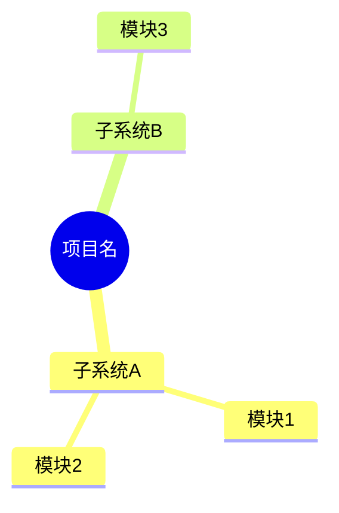
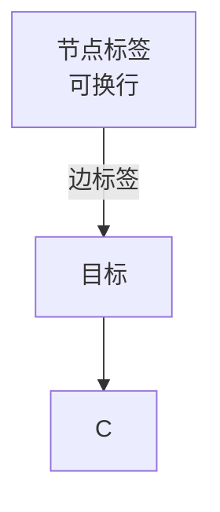
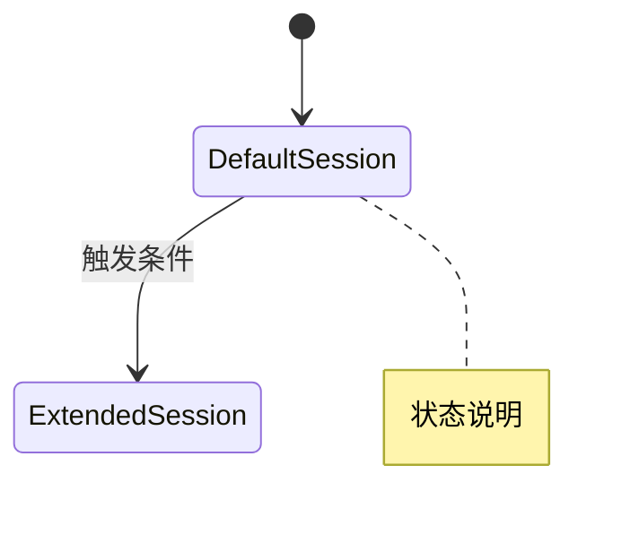
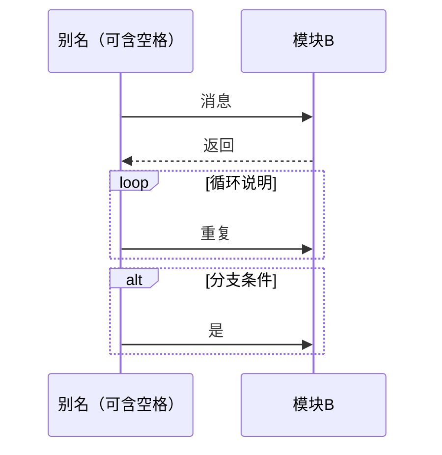

# Mermaid 四类图表指南 + 已知坑

> 本指南来自实测（mermaid-cli 渲染验证），记录**会真的让图表渲染失败**的语法坑。写图表前必读。

## 四类图表与适用场景

### 1. mindmap — 思维导图（导航/概览）

**坑**：节点文本中**不能有 `空格 + 括号` 组合**（如 `Dcm (DSL/DSD/DSP)`）——会触发形状解析失败。改法：去掉括号或用引号无济于事，直接去掉括号写 `Dcm DSL/DSD/DSP`。单括号 `A (x)` 可以，但 `A (x/y) z` 不行。

### 2. flowchart — 流程图/分层/数据流

- 标签含特殊字符（`/`、`→`、`(` 等）时**必须用双引号包裹**：`A["Can_RxAppMsgHandle<br/>缓存列表"]`
- `subgraph 名称["显示名"]` ... `end` 用来分区（分层图核心）
- 自环 `TX_CF --> TX_CF` 合法
- **坑**：`end` 关键字不能用作节点 ID；`subgraph` 与 `end` 必须配对

### 3. stateDiagram-v2 — 状态机

**坑（最重要）**：状态 ID **不能叫 `DEFAULT`/`Default`**（大小写都不行）——是 Mermaid 保留字，渲染报 `Expecting 'ID', got 'DEFAULT'`。改法：`DefaultSession`、`S_DEFAULT` 等带后缀名。其余如 `EXTENDED`/`PROGRAMMING` 可用。

### 4. sequenceDiagram — 时序图

- `participant X as 别名` 别名可含空格/括号
- `<br/>` 在消息文本中可用于换行
- 消息文本含 `$`、`/`、`()` 等没问题（不像 flowchart 需引号）

## 通用规范

- 图表块统一用 ` ```mermaid ` 围栏（Obsidian 原生渲染，无需插件）
- 节点标签用中文可以，但特殊字符必须引号（flowchart）或避免（mindmap）
- **写完后必须过质量门**：轻量 `validate-kb.js` + 有条件时 `render-mermaid.js` 全量渲染

## 渲染验证（P7）

```bash
# 轻量校验（无依赖，必跑）
node ~/.claude/skills/project-knowledge-base/scripts/validate-kb.js <vault>

# 全量渲染（需 mermaid-cli，首次下载 chromium）
node ~/.claude/skills/project-knowledge-base/scripts/render-mermaid.js <vault>
```

渲染失败的修复流程：
1. 看报错行号 + `Expecting ... got ...` 定位到具体行
2. 对照上文的坑排查（保留字、括号、引号、subgraph/end）
3. 修复后重跑直至 100% 通过

## 实测过的保留字/语法结论（备忘）

| 写法 | 结果 | 备注 |
|---|---|---|
| `stateDiagram-v2` 状态名 `DEFAULT` | ❌ 失败 | 保留字，改 `DefaultSession` |
| `stateDiagram-v2` 状态名 `Default` | ❌ 失败 | 同上 |
| mindmap 节点 `A (x/y) z` | ❌ 失败 | 空格+括号+斜杠组合 |
| mindmap 节点 `A (x)` | ✅ 通过 | 单括号可用 |
| mindmap 节点 `Dcm ← 激活` | ✅ 通过 | 箭头符号 OK |
| flowchart 标签 `"0x7DF/0x70A"`（引号） | ✅ 通过 | 必须引号 |
| sequence 别名 `main() while(1)` | ✅ 通过 | 空格括号 OK |
